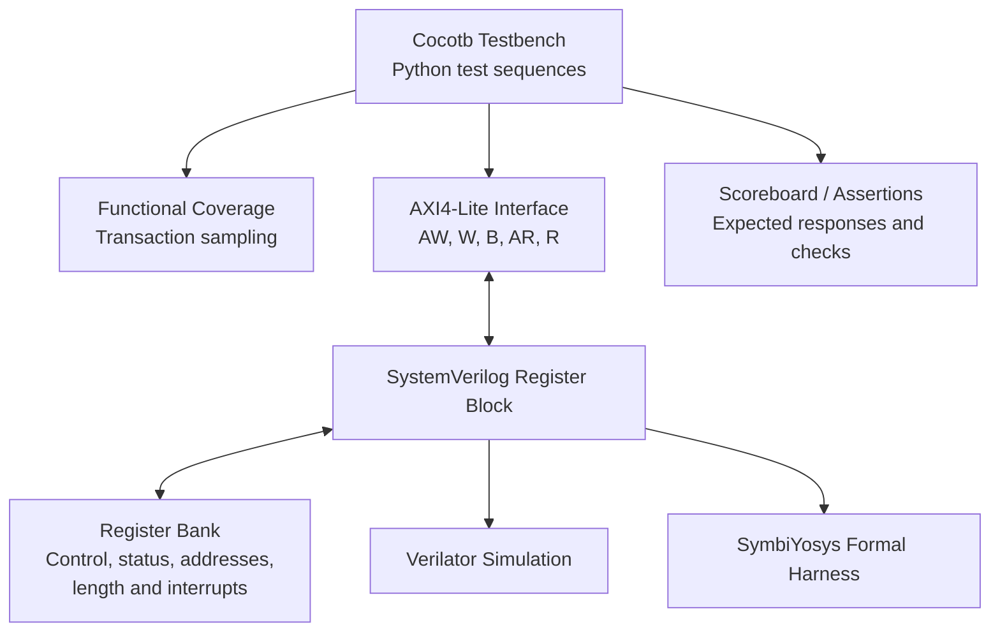

# AXI4-Lite DMA Register Verification

**SystemVerilog | Cocotb | Verilator | SymbiYosys | Functional Coverage**

An RTL verification project focused on validating an AXI4-Lite register interface intended for a Direct Memory Access (DMA) controller. The environment combines Python-based simulation testing, transaction-level functional coverage, and formal verification.

**Repository:** [github.com/syedalicodes/axi4-dma-verification](https://github.com/syedalicodes/axi4-dma-verification)

---

## 1. Project Overview

The objective is to develop a reusable verification environment for an AXI4-Lite register block that provides software access to DMA control, configuration, status, and interrupt registers.

The project targets common hardware verification challenges, including independent AXI write channels, response backpressure, invalid address handling, byte-strobe behavior, register readback, reset behavior, and interrupt functionality.

### Objectives

- Verify register reads and writes against the documented register map.
- Exercise independent AXI write-address and write-data channel handshakes.
- Validate write and read response backpressure behavior.
- Check byte-strobe handling and invalid-address responses.
- Exercise interrupt-enable and interrupt-status behavior.
- Measure user-defined transaction functional coverage.
- Prove selected RTL properties using formal verification.

**Current scope:** AXI4-Lite register-block verification. A complete DMA datapath and end-to-end memory transfer engine are not yet implemented in this project.

---

## 2. Architecture

### Verification architecture



### Main components

| Component | Responsibility |
|---|---|
| SystemVerilog RTL | Implements the AXI4-Lite register interface and register behavior |
| Cocotb testbench | Drives transactions and checks expected results |
| Verilator | Executes RTL simulation |
| Functional coverage | Tracks defined register, strobe, response, and scenario bins |
| Formal harness | Defines properties and assumptions for formal analysis |
| SymbiYosys | Runs the configured formal proof flow |
| Coverage report | Records coverage-bin hits and sample counts |

The diagram represents the verification environment and its intended relationships; it does not imply that every block is a separately implemented RTL module.

---

## 3. Technology Stack

| Technology | Purpose |
|---|---|
| SystemVerilog | RTL design and formal harness |
| Python | Verification logic and test orchestration |
| Cocotb | Python-driven HDL verification |
| Verilator | RTL simulation |
| SymbiYosys (SBY) | Formal verification orchestration |
| Yosys / formal engine | Formal model processing and proof execution |
| Git and GitHub | Version control and project hosting |
| Ubuntu on WSL2 | Development environment |

Tool versions can vary between environments. Check the installed versions when reproducing the results.

---

## 4. Register Map

The register block exposes the following 32-bit register addresses.

| Register | Address | Description |
|---|---:|---|
| `CONTROL` | `0x00` | Control and DMA start command |
| `STATUS` | `0x04` | Busy, done, and error status |
| `SRC_ADDR` | `0x08` | Source address configuration |
| `DST_ADDR` | `0x0C` | Destination address configuration |
| `LENGTH` | `0x10` | Transfer length configuration |
| `WORDS_DONE` | `0x14` | Transfer progress |
| `IRQ_ENABLE` | `0x18` | Interrupt-enable configuration |
| `IRQ_STATUS` | `0x1C` | Interrupt status |
| `ERROR_CODE` | `0x20` | Error information |

### AXI response codes

| Response | Encoding | Meaning |
|---|---:|---|
| `OKAY` | `2'b00` | Successful transaction |
| `SLVERR` | `2'b10` | Access error, such as an invalid address |

The register implementation is the source of truth for register access permissions, reset values, and field semantics. Refer to `rtl/axi4_lite_regs.sv` and `docs/specification.md` for implementation details.

---

## 5. Verification Plan

The Cocotb regression exercises the following behaviors.

| Verification area | Checks performed |
|---|---|
| Reset | Reset behavior and register readback |
| Register access | Reads and writes to supported registers |
| Independent write channels | AW and W handshakes can occur independently |
| Write backpressure | Write-response handling when the receiver stalls |
| Read backpressure | Read-response handling under backpressure |
| Invalid addresses | Error response for unsupported register addresses |
| Byte strobes | Supported strobe patterns and partial-write behavior |
| Interrupts | Interrupt-enable and interrupt-status behavior |
| Register coverage | Access to all defined register-read bins and writable-register bins |
| Response coverage | Observation of `OKAY` and `SLVERR` |
| Scenario coverage | Sampling of all six defined scenario bins |

### Functional coverage model

The current user-defined functional coverage model contains **31 bins**:

| Coverage category | Defined bins |
|---|---:|
| Register reads | 9 |
| Software-writable registers | 6 |
| Byte-strobe patterns | 8 |
| AXI response types | 2 |
| Verification scenarios | 6 |
| **Total** | **31** |

Coverage is sampled by the Python verification environment during transactions and scenario execution.

### Assertions and formal verification

The formal harness is located at `formal/axi4_lite_regs_formal.sv`, with its SymbiYosys configuration at `formal/axi4_lite_regs.sby`.

Formal verification complements simulation by checking the properties and assumptions encoded in the harness. A passing proof does not establish that every possible property of the complete DMA system has been verified.

---

## 6. Verification Results

The latest recorded regression produced the following results.

| Metric | Result |
|---|---:|
| Cocotb tests passed | 21 |
| Cocotb tests failed | 0 |
| Cocotb tests skipped | 0 |
| Defined functional coverage bins hit | 31/31 |
| Defined functional coverage | 100.0% |
| Register-read samples | 181 |
| Register-write samples | 113 |
| AXI response samples | 294 |
| Formal proof status | `PASS` |

### Coverage interpretation

The reported 100% coverage means that every bin in the **defined functional coverage model** was hit.

It does not mean 100% RTL statement coverage, branch coverage, toggle coverage, or exhaustive verification of every possible AXI transaction.

The formal result is based on the configured formal harness and proof properties.

The report is available at `reports/functional_coverage.txt`.

---

## 7. Setup and Execution

### Prerequisites

Install or configure the following in Ubuntu or WSL2:

- Python 3
- A Python virtual environment
- Cocotb
- Verilator
- SymbiYosys and its required formal tools
- GNU Make

### Clone the repository

```bash
git clone https://github.com/syedalicodes/axi4-dma-verification.git
cd axi4-dma-verification
```

### Create an environment

```bash
python3 -m venv .venv
source .venv/bin/activate
python -m pip install --upgrade pip
python -m pip install cocotb
```

Ensure Verilator, GNU Make, and the formal tools are installed separately. Use the versions compatible with the project's Makefile and formal configuration.

### Run the simulation regression

```bash
make clean
make PYTHON_BIN="$VIRTUAL_ENV/bin/python"
```

The regression runs the Cocotb tests against the SystemVerilog RTL using the configured simulator.

### Inspect the functional coverage report

```bash
cat reports/functional_coverage.txt
```

The report is generated by the testbench and reflects the coverage sampled during that run.

### Run formal verification

```bash
sby -f formal/axi4_lite_regs.sby
```

Inspect the final status:

```bash
cat formal/axi4_lite_regs/status
```

A `PASS` status indicates that the configured formal proof completed successfully. If tools, configuration, or RTL have changed, rerun the proof before reporting a new result.

---

## 8. Project Structure

```text
axi4-dma-verification/
├── docs/
│   └── specification.md
├── formal/
│   ├── axi4_lite_regs.sby
│   └── axi4_lite_regs_formal.sv
├── reports/
│   └── functional_coverage.txt
├── rtl/
│   └── axi4_lite_regs.sv
├── tb/
│   ├── functional_coverage.py
│   └── test_axi4_lite_regs.py
├── .gitignore
├── Makefile
└── README.md
```

| File | Purpose |
|---|---|
| `rtl/axi4_lite_regs.sv` | AXI4-Lite register-block RTL |
| `tb/test_axi4_lite_regs.py` | Cocotb test sequences and checks |
| `tb/functional_coverage.py` | User-defined functional coverage model |
| `formal/axi4_lite_regs_formal.sv` | Formal verification harness |
| `formal/axi4_lite_regs.sby` | Formal tool configuration |
| `reports/functional_coverage.txt` | Recorded functional coverage results |
| `docs/specification.md` | Register-block specification |
| `Makefile` | Simulation build and regression commands |

---

## 9. Limitations and Future Work

### Current limitations

- Verification scope is limited to the AXI4-Lite register block.
- The project does not yet implement or verify a complete DMA data-transfer datapath.
- The 100% functional coverage result applies only to the defined 31-bin coverage model.
- Formal proof guarantees are limited to the properties, assumptions, and design model used by the formal harness.
- The current test and coverage results should not be interpreted as exhaustive verification of the AXI protocol or a production DMA engine.

### Planned improvements

1. Implement a DMA controller datapath and memory transaction model.
2. Add end-to-end source-to-destination data-integrity tests.
3. Expand constrained-random stimulus and corner-case scenarios.
4. Add stronger SystemVerilog assertions for protocol and control properties.
5. Integrate automated regression into GitHub Actions.
6. Add additional coverage models for DMA transfer lengths, boundary conditions, and error recovery.
7. Expand formal properties and prove additional control and protocol invariants.

---

## 10. Author

**Syed Ali U Khan**

- GitHub: [@syedalicodes](https://github.com/syedalicodes)
- Project repository: [AXI4-Lite DMA Register Verification](https://github.com/syedalicodes/axi4-dma-verification)

This project demonstrates hands-on work with RTL verification, Python-based simulation, functional coverage, protocol corner cases, and formal verification workflows.


